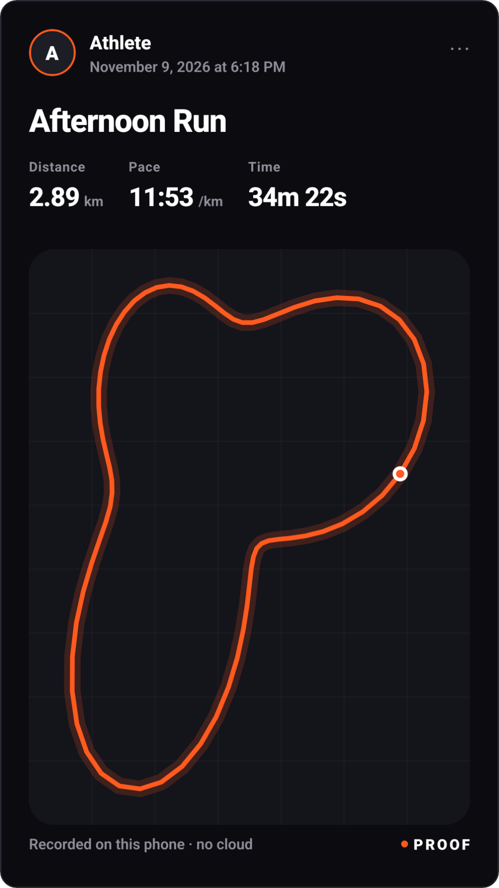
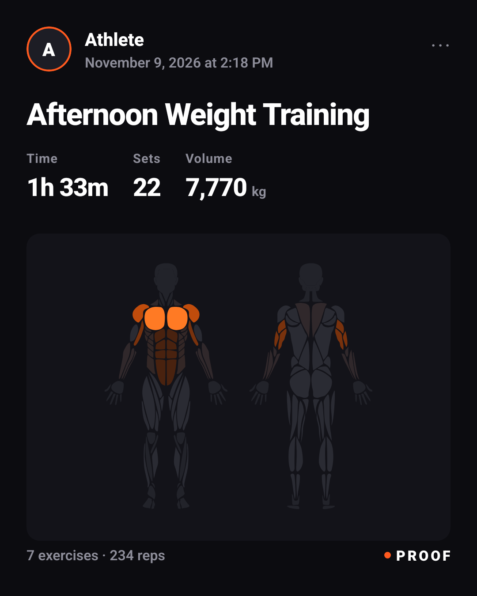
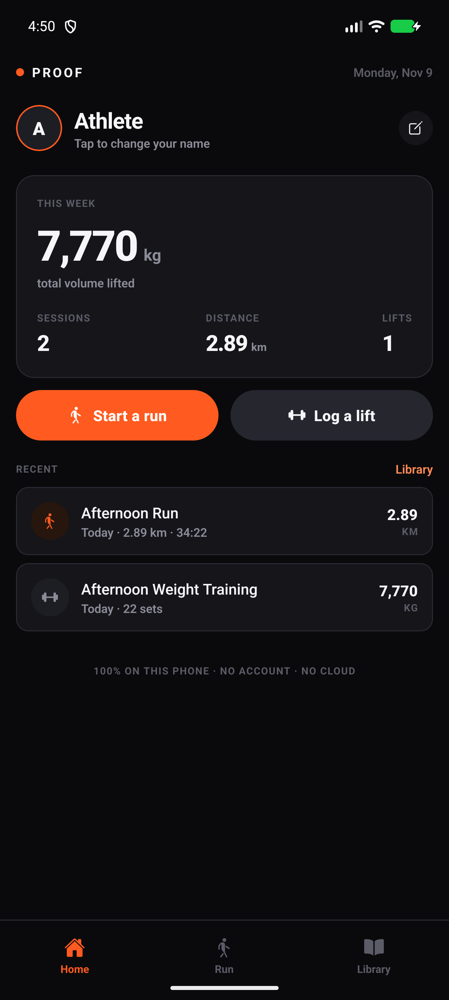
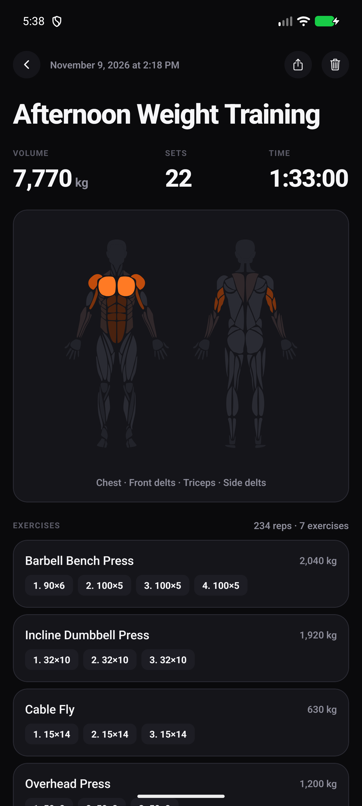
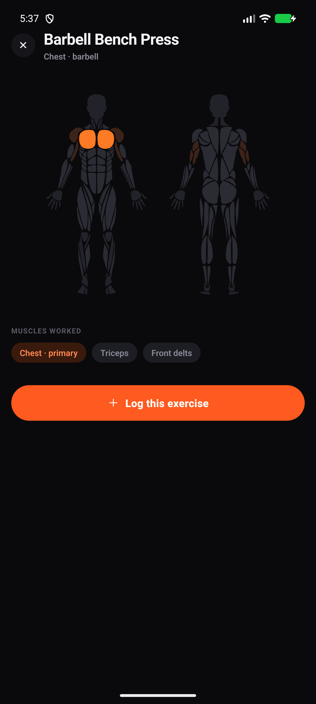

# Proof

**Proof of work — for lifting and running.** A small Android app that runs
entirely on the phone: no account, no server, nothing uploaded. Log what you
lift, see the total volume and which muscles it hit, record a run with GPS, then
export a share card sized for Instagram or Strava.

The point: you don't need Strava Premium, or any subscription, to post a
correct-looking training card with a route on it.

```
dist\proof-0.6.0.apk
```

| Run card (story, 1080×1920) | Lift card (feed, 1080×1350) |
| --- | --- |
|  |  |

| Home | Session detail | Library |
| --- | --- | --- |
|  |  |  |
---

## What v0.6 does

| Screen | What it does |
| --- | --- |
| **Home** | This week's volume, sessions and distance; recent activity; your name (used on cards). |
| **Log a lift** | Search 100+ exercises, add sets (weight × reps), live total volume, finish → saved session. |
| **Run** | GPS recording: live distance / pace / time and the route drawing itself. Pause, resume, finish. Optional foreground service keeps recording with the screen off. Import a `.gpx` from any watch, or log a treadmill run by hand. |
| **Library** | Every exercise with its muscle map — front and back, primary vs secondary. |
| **Progress** | Home charts: volume for the last six weeks, and the muscles you actually hit this week. |
| **Templates** | Save a session's exercises as "Push A" and start the next one from it, weights pre-filled. Long-press a chip to delete. |
| **RPE** | Tap the `RPE` badge on a set to record effort 6–10; it follows the set into the history and the card. |
| **Week recap** | A shareable Monday-to-now card: volume, sessions, distance and the whole week's muscle map. Cards come in a dark or light theme. |
| **Session** | Full breakdown: volume, sets, an anatomy heatmap of what you trained — or the route. |
| **Share card** | 9:16 story or 4:5 feed, exported at 1080 px wide, saved to the gallery or sent to any app. |

Everything lives in a local SQLite database in the app's private storage.
Uninstall and it's gone. Nothing is ever sent anywhere.

---

## The three bits of maths that matter

**1. Volume.** `Σ (weight × load factor × reps)` over the session. The load
factor is what most apps quietly get wrong:

- barbell / machine / cable / kettlebell → ×1
- dumbbell exercises → ×2, because you type the weight of **one** dumbbell
- bodyweight → ×0 (still counts as sets and muscle work, adds no tonnage)

**1b. Distance work.** Carries, sleds and machine cardio are logged in **metres**
instead of reps (weight is optional: a farmer's carry has both, a rowing machine
has only distance). Those sets contribute **kg·m** — `weight × load factor ×
metres` — which is shown as *Carried* instead of *Volume*, so "40 kg × 20 m" is
1,600 kg·m and a 2,000 m row is 2,000 m with no tonnage. Mixing the two in one
session is fine; the summary reports both.

**1c. PRs.** Best estimated 1RM per exercise (Epley on total load), compared only against sessions that *started earlier* — so reopening an old session never makes it beat itself, and a first-ever lift is not a PR.

**2. Muscle map.** `Σ hard sets per muscle`, weighted by role — primary 3 → 1.0,
secondary 2 → 0.55, stabiliser 1 → 0.28 — then normalised to the hardest-hit
muscle. Sets-based rather than tonnage-based on purpose: the card should answer
"what did I train", not "what was heaviest".

**3. Route.** GPS points are filtered (accuracy, teleports), simplified with
Ramer–Douglas–Peucker, then drawn as vector art on a grid. No map tiles, so the
card renders identically with no network and no API key.

---

## The muscle map

The body is a real anatomical illustration — one SVG path per muscle head, front
and back — not a mannequin with blobs. It comes from
[`react-native-body-highlighter`](https://github.com/HichamELBSI/react-native-body-highlighter)
(MIT, © 2022 ELABBASSI Hicham); the geometry is vendored as data in
`src/data/body/` with its LICENSE, so the app has no runtime dependency on that
package and does not bundle the female variants or the React component.

Our 18 muscle groups map onto its drawn parts:

| Our id | Art slug (front) | Art slug (back) |
| --- | --- | --- |
| chest | chest | — |
| front_delt, side_delt | deltoids | — |
| rear_delt | — | deltoids |
| traps | trapezius | trapezius |
| lats, mid_back | — | upper-back |
| lower_back | — | lower-back |
| biceps | biceps | — |
| triceps | triceps | triceps |
| forearms | forearm | forearm |
| abs | abs | — |
| obliques | obliques | — |
| glutes | — | gluteal |
| quads | quadriceps | — |
| adductors | adductors | adductors |
| hamstrings | — | hamstring |
| calves | calves | calves |

Two ids can share one shape (lats and mid-back are the same drawn muscle from
behind); when they do, the intensity is the stronger of the two plus a small
bonus, so a row that hammers both reads slightly hotter than one that only
brushes them.

**Why a muscle glows as much as it does.** Intensity is relative within the
session (the hardest-hit muscle is 1.0), then gamma-corrected when the colour is
picked. The role weights are harsh on purpose — primary 1.0, secondary 0.45,
stabiliser 0.16 — because otherwise a 3-set forearm hold on a hanging leg raise
outshines the bench press you actually came to do.

---

## Install on a phone

**Easiest — download the APK on the phone:**

<https://github.com/gipinze/proof/releases/latest>

Tap the `proof-0.6.0.apk` asset, then allow "install unknown apps" for your
browser when Android asks. Requires Android 7+ (`minSdkVersion 24`); the APK has
`arm64-v8a` and `x86_64` binaries.

Other routes:

```powershell
adb install -r dist\proof-0.6.0.apk     # phone plugged in, USB debugging on
npm run apk                             # rebuild the release APK yourself
```

The APK is signed with the standard Android debug keystore — fine for
sideloading, not for Play Store distribution (that needs your own upload key).

Permissions: **location** (route recording) and **photos** (saving cards).
Nothing else — see the permission table further down.

---

## Build and run it

```powershell
npm install

npm run android          # debug build + Metro + install + launch (hot reload)
npm run android:release  # standalone release build, no Metro
npm run studio           # open Android Studio on the buildable project
npm run apk              # only produce the release APK
```

`npm run android` is the whole loop: sync source → build → install on the
connected emulator/phone → start Metro if needed → launch. Edit JS, save, then
press **R** twice in the app (or `Ctrl+M` → Reload).

### Why a build mirror

Windows caps most toolchain paths at 260 characters, and the Android C++ codegen
builds paths out of the *project* directory. This folder sits 61 characters
before `node_modules`, so the native step dies with
`ninja: error: mkdir(...): No such file or directory`.

The scripts therefore build from `F:\pb` (a short mirror kept in sync by
`scripts/sync-mirror.ps1`); this folder stays the source of truth. Nothing about
the app is affected.

**Move the project to a short path** (e.g. `C:\proof`) and the mirror becomes
unnecessary: `npx expo prebuild -p android`, `npx expo run:android`, open
`android/` in Studio. Folder depth is the only reason for any of it.

### Permissions

| Permission | Why |
| --- | --- |
| `ACCESS_FINE_LOCATION`, `ACCESS_COARSE_LOCATION` | recording a run route |
| `READ_MEDIA_IMAGES` (Android 13+) / `WRITE_EXTERNAL_STORAGE` (≤ 28) | saving a card to the gallery |
| `INTERNET` | only in debug, to fetch the JS bundle from Metro |

Deliberately **not** requested: media audio/video (the library declares them by
default; `plugins/withTrimmedPermissions.js` strips them, so the first save no
longer asks for "music and audio"), and `ACCESS_LOCAL_NETWORK`, which React
Native's debug manifest adds for its dev overlay and which prompts "nearby
devices" on every fresh debug install.

### If something doesn't load

- **"Unable to load script"** in a debug build: Metro isn't reachable. Check
  `npm run android` started it (or run `npm start`), then
  `adb reverse tcp:8081 tcp:8081`. Debug builds need cleartext HTTP for that —
  `plugins/withTrimmedPermissions.js` sets `usesCleartextTraffic` in the debug
  manifest for exactly this reason.
- **`ninja: error: mkdir(...)`**: you're building from this deep folder instead
  of the mirror — use `npm run android`, or move the project somewhere short.

### Dev loop

```powershell
npm start                        # Metro only
npm run typecheck                # tsc --noEmit
node scripts/render-highlighter.cjs   # rasterise the muscle art to preview/out
pwsh scripts/shot.ps1 name       # screenshot the connected device
```

---

## Project layout

```
App.tsx                   screen stack, tab bar, shared workout draft
src/
  data/
    anatomy.ts            muscle id ↔ drawn-body-part mapping + intensity maths
    body/                 vendored anatomical SVG paths (MIT, see body/LICENSE)
    muscles.ts            18 muscle groups, display names
    exercises.ts          168 exercises: category, equipment, load factor, muscle roles, measure
  components/
    AnatomyMap.tsx        renders the body views with the heat ramp
    RouteMap.tsx          tile-free route art
    ShareCard.tsx         the card: story + feed layouts
    ExercisePicker.tsx    searchable modal
    ui.tsx                Screen / Card / Stat / Button / Chip primitives
  screens/                Home, Log, Run, Library, Session, Share
  db/                     expo-sqlite schema + queries, settings
  lib/
    volume.ts             volume and muscle-load maths
    geo.ts                haversine, simplification, projection
    format.ts             km / pace / duration / date formatting
    share.ts              captureRef → gallery / share sheet
  dev/sample.ts           two sample sessions so a fresh install can see a card
scripts/
  build-android.ps1       mirror + gradle + install + screenshot
  shot.ps1                screenshot the connected device
  render-highlighter.cjs  rasterise the body views to preview/out (sharp)
  vendor-body-anatomy.cjs regenerates src/data/body from the upstream package
  audit-muscles.cjs       compare our exercise→muscle data with the reference set
```

### Database

```sql
sessions(id, kind 'lift'|'run', title, started_at, ended_at, duration_s,
         notes, distance_m, track /* JSON [[lat,lng,t],…] */)
sets(id, session_id, exercise_id, ordinal, weight, reps, is_warmup)
settings(key, value)
```

---

### Your data survives updates

The database carries a `user_version` and upgrades in place (`src/db/db.ts`):

| Version | Change |
| --- | --- |
| 2 | `sets.distance_m` — carries, sleds and cardio measured in metres |
| 3 | `sets.duration_s` — per-set time, for intervals and cardio |
| 4 | `templates` — saved workouts to start from |
| 5 | `sets.rpe` — effort per set, optional |

Each is an `ALTER TABLE … ADD COLUMN` guarded by `PRAGMA table_info`, so an
existing database gains the column without touching a row. Verified twice by
installing over a live install: 0.2.0 over 0.1.0, then 0.3.0 over 0.2.0 — all
sessions, sets and weekly totals came through each time.

**Signing.** Android only allows an in-place update when the signing key matches
the installed app. The key now lives in this repo folder at
`signing/proof.keystore` (gitignored, with `signing/keystore.properties`), and
`plugins/withReleaseSigning.js` wires it into release builds. It is a copy of the
identity your phone already trusts, so switching did not break updates — the
0.3.0 APK has the same certificate digest as 0.2.0, confirmed with `apksigner`.

Keep those two files safe and private. Lose them and you cannot update an
installed app without an uninstall, which wipes the database. Back them up
(password manager, private drive) before you publish anything.

Rules of thumb:

- Install updates **over** the old app (`adb install -r`, or tap the new APK) —
  never uninstall first.
- Adding a schema change later: bump `SCHEMA_VERSION`, add a `from < N` case.
- Play Store distribution needs a *different*, properly protected upload key —
  and that switch costs one uninstall. Do it before you accumulate real data if
  you plan to publish.

---

## Deliberate v0.6 limits

- **Background run tracking is opt-in** (switch on the Run tab). It uses a
  foreground service and needs “Allow all the time” location; when it is off, or
  the permission is refused, recording falls back to foreground-only. Verified
  that the service starts and stops on an emulator, but the actual keep-recording
  -with-the-screen-off path needs a real device walk.
- **No history charts yet.** Sessions and per-session breakdown exist; trends do not.
- **No heart rate / watch sync.** The card shows Sets where Strava shows Avg HR.
- **Treadmill runs** need manual entry (not implemented yet).
- Exported files are named `ReactNative-snapshot-…png` by the capture library.
- **The map is left/right symmetric** and stylised male anatomy: the art has no
  per-side injury tracking, no female variant wired up (the paths exist upstream),
  and no neck, tibialis or serratus groups.
- The exercise→muscle data is hand-curated for 101 movements — it is opinionated,
  not a lab measurement.

---

## Roadmap, in the order I'd build it

1. **Background run tracking** — foreground service, lock the screen and go.
2. **Named exports + albums** — `proof-2026-11-09-run.png` in a `Proof` album.
3. **Card themes** — Strava-like (now), minimal, brutalist-stats; accent picker.
4. **PR detection** — best e1RM per exercise (Epley), PR badges on the card.
5. **Split history charts** — volume per muscle group per week; spot what you skip.
6. **Templates** — "Push A" that pre-fills exercises and last-used weights.
8. **Weekly recap card** — the 7-day summary as its own story.
7. **Per-set notes** and a plate calculator.
10. **Bodyweight mode** — reps-based volume for calisthenics.

---

## Where the muscle data came from (and what I threw away)

Two older projects were reviewed:

**`Exercise Analyzer`** (sibling project) — a desktop Streamlit app for
pose-based form analysis (MediaPipe/RTMPose keypoints, rep state machine, rules
for depth/torso-lean/valgus/tempo, SQLite history, self-contained HTML reports).

- **Reused:** the exercise vocabulary (`squat`, `deadlift`, `overhead_press`,
  `romanian_deadlift`, …) and the conventions for naming movements.
- **Reused as a pattern:** per-rep profiling, SQLite as the single source of
  truth, an exportable share artefact.
- **Not reused:** it has **no exercise→muscle mapping at all** — I searched every
  file in it — and its MediaPipe/OpenCV/Streamlit stack is desktop Python.

**`TrainHeroic clone`** (sibling project) — this is where the muscle
work actually lives: `exercise-enrichment.sql` assigns `worked_muscles`,
`secondary_muscles`, `muscle_group` and `equipment` to **1,927 exercises**,
generated by a local `qwen2.5:14b` run on 2026-09-13. Seventeen muscle labels:
trapezius, quadriceps, back-deltoids, hamstring, gluteal, front-deltoids, abs,
upper-back, biceps, triceps, forearm, calves, obliques, chest, lower-back,
adductor, abductors.

What I took from it:

- **The idea of the anatomical body map.** The clone uses
  `react-native-body-highlighter` (MIT); Proof now vendors the same artwork
  instead of my hand-drawn silhouette. That was the actual accuracy problem:
  the old map was blobs on a mannequin.
- **A cross-check for my own 101 exercises.** `scripts/audit-muscles.cjs` diffs
  the two datasets muscle by muscle (58 disagreements out of 101).

What I did **not** take — because the reference is flat (2–5 unweighted labels,
no primary/secondary/stabiliser roles) and has its own errors:

| Exercise | Reference says | Reality |
| --- | --- | --- |
| Overhead Press | `back-deltoids` primary | rear delts are not a prime mover overhead |
| Dumbbell Shoulder Press | `back-deltoids` primary | same |
| Pec Deck | `triceps` primary | the elbow is locked; triceps barely work |
| Cable Fly | `trapezius` primary | shrug-adjacent at most |
| Deadlift | `quadriceps` primary | hip-dominant, quads assist |

I did adopt the handful of **genuine** gaps it exposed: quads on the deadlift,
upper traps on the overhead press, front delts on decline bench and pec deck,
traps + trunk on barbell row, traps on pull-up, lats on toes-to-bar, and grip
work demoted from "secondary" to "stabiliser" on hanging movements.

If we later want to grow the library past ~100 movements, that 1,927-row
enrichment is the best starting corpus — but it needs a cleaning pass first
(`scripts/compare-muscles.cjs` survives the parsed JSON as
`.cache/reference-muscles.json`).

If we ever add camera rep-counting on the phone, the Analyzer's rule engine is
the thing to port.

---

MIT. Go lift something and post the receipt.
